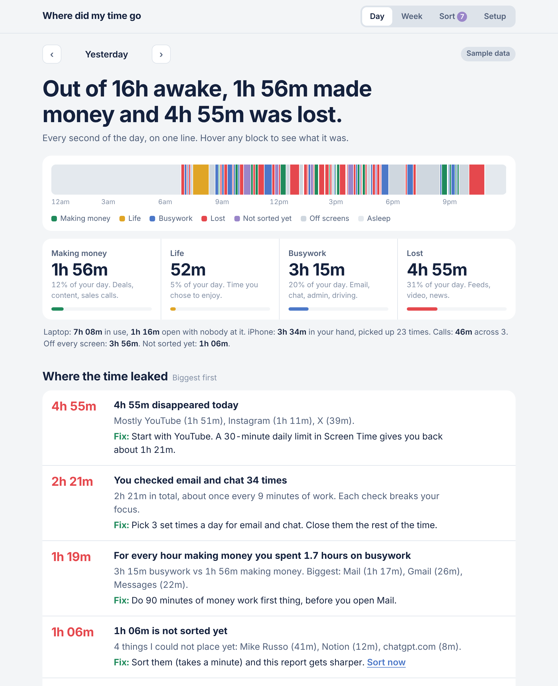
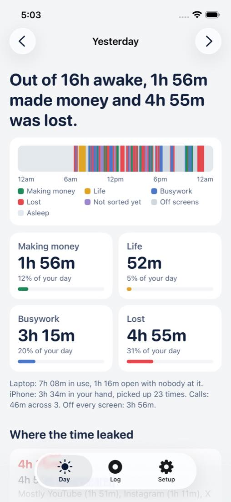
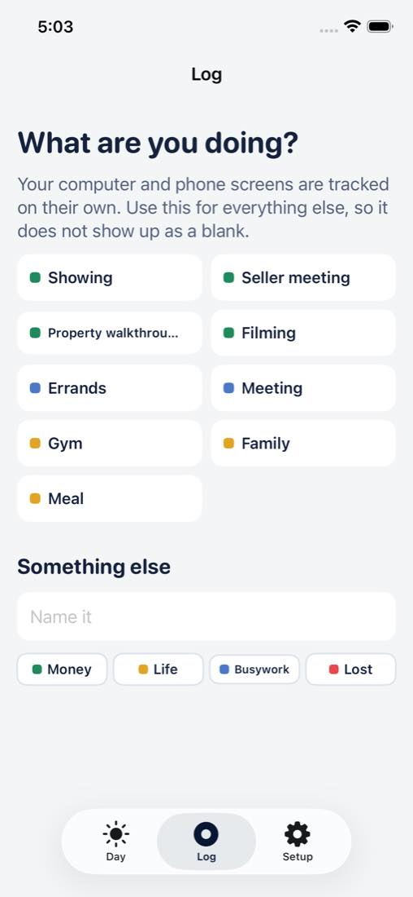

# WDMTG: Where Did My Time Go

Tracks every second of your day across your Mac and iPhone, sorts it into four buckets, and tells you in plain English where the time was lost.



## The four buckets

| Bucket | What goes in it |
|---|---|
| **Making money** | Deals, content, sales calls, anything that produces income |
| **Busywork** | Email, chat, admin, driving. Work that keeps you busy but does not pay |
| **Life** | Time you chose to enjoy |
| **Lost** | Feeds, video, news. Time that just disappears |

The app guesses where each app and site belongs. You fix the guesses with one tap in the **Sort** tab, and the fix applies to your whole history.

## What it tracks, and how

| What | How | Needs |
|---|---|---|
| Every app, window and web page on your Mac, second by second | Checks the front window once a second | Screen Recording + Accessibility permission |
| Whether you were actually there | Time since your last key press or mouse move. After 2 minutes it counts as "laptop open, nobody at it" | Nothing |
| Every app on your iPhone and for how long | Your iPhone shares Screen Time with your Mac through iCloud. The Mac app reads it | Full Disk Access + "Share Across Devices" |
| Phone calls: who and how long | Your call history syncs to your Mac through iCloud. The Mac app reads it | Full Disk Access + your Mac password once |
| Drive time | Your iPhone logs when you are in a car on its own. The iPhone app reads the last 7 days | iPhone app + Motion permission |
| Everything off screen (showings, gym, family) | One tap in the iPhone app, or label the gap on the dashboard afterwards | You |

**Two things Apple does not allow, on any app:** an iPhone app cannot see your other apps, and it cannot see your call log. That is why the Mac is the hub and reads both from iCloud. It also means iPhone usage shows up an hour or two behind, because Apple syncs on its own schedule.

**What it never does:** no keystrokes, no screenshots, no cloud. Everything is stored in one file on your Mac.

## Install the Mac app

1. Open the [latest build](../../actions/workflows/build.yml), click the newest run with a green check, and download **WDMTG-mac** at the bottom.
2. Unzip it. Open the `.dmg` that matches your Mac (`arm64` for Apple Silicon, `x64` for Intel) and drag WDMTG to Applications.
3. Open it. macOS will block it the first time because the app is not from the App Store. Go to **System Settings > Privacy & Security**, scroll down, click **Open Anyway**.
4. The app opens on the **Setup** tab. Work down the list until everything is green:
   - **See which page or document:** turn on WDMTG under Screen Recording and under Accessibility. Quit and reopen.
   - **iPhone app usage:** on your iPhone, Settings > Screen Time > turn on **Share Across Devices**. Same on the Mac. Then turn on WDMTG under **Full Disk Access**. Quit and reopen.
   - **Phone calls:** click **Unlock caller names**, type your Mac password, choose **Always Allow**.
   - **Start when you log in:** turn it on. Tracking only happens while the app is running.
5. Leave it running. Closing the window does not stop it. It lives in the menu bar.

Once Full Disk Access is on, the app also pulls in whatever recent history Screen Time already holds for your iPhone and Mac, so the first report is not empty.

## See it on your iPhone (takes 10 seconds)

In the Mac app go to **Setup > Your phone** and point your iPhone camera at the code. The dashboard opens in Safari. Works whenever your phone is on the same Wi-Fi as your Mac.

## Install the iPhone app (optional, needs Xcode)

 

The iPhone app adds drive tracking and one-tap logging of off-screen time. It is not on the App Store, so you install it from your Mac:

1. Install Xcode from the Mac App Store.
2. Download this repo and open `ios/WDMTG.xcodeproj`.
3. Click **WDMTG** in the left sidebar > **Signing & Capabilities** > pick your Apple Account as the Team.
4. Plug in your iPhone, pick it at the top of the window, press **Run**.
5. On the phone, scan the code from **Setup > Your phone** on the Mac. On the page that opens, tap **Setup > Connect the iPhone app**.

With a free Apple Account the app stops opening after 7 days and you press Run again. A paid developer account ($99/year) makes it last a year.

## How "lost time" is found

Every second gets exactly one owner. When things overlap, this is who wins: something you logged yourself, then a call, then driving, then the Mac (only while you are actually using it), then the iPhone. Whatever is left is either sleep (a long gap overnight) or "off screens".

From that one clean line of time the app looks for:

- **Lost time** and the 3 apps that took most of it
- **Busywork beating money work**, as a ratio
- **Inbox checking:** how many separate times you opened email or chat
- **Phone pickups in the middle of laptop work**
- **Chopped-up focus:** your longest unbroken stretch of money work
- **Constant app switching**
- **Calls that are not tied to money** (until you sort your callers)
- **Work after 8pm**
- **Laptop open with nobody at it**

## For developers

```
desktop/   Electron app. src/core is plain Node with no Electron in it.
ios/       SwiftUI app. WDMTG/Core is pure logic, tested with `swift test`.
```

```bash
cd desktop
npm install
npm test         # 38 tests
npm run demo     # dashboard with sample data at http://127.0.0.1:48321
npm start        # the real app
npm run dist     # build the .dmg (on a Mac)
```

Data lives in `~/Library/Application Support/WDMTG/wdmtg.db` (SQLite). Delete that file to start over.

The dashboard is served on your local network on port 48321 so your phone can reach it. Requests from other devices need the pairing token from the QR code. It is plain HTTP, so only pair on a Wi-Fi network you trust.

Windows: the tracker and dashboard run (`npm start`), but iPhone usage and call history are Mac only, and there is no Windows installer yet.

## Credits

The iPhone Screen Time reader follows the approach in [nichtlegacy/screentime](https://github.com/nichtlegacy/screentime) (MIT) and the SEGB file layout documented by [CCL Forensics' ccl-segb](https://github.com/cclgroupltd/ccl-segb) (MIT).
